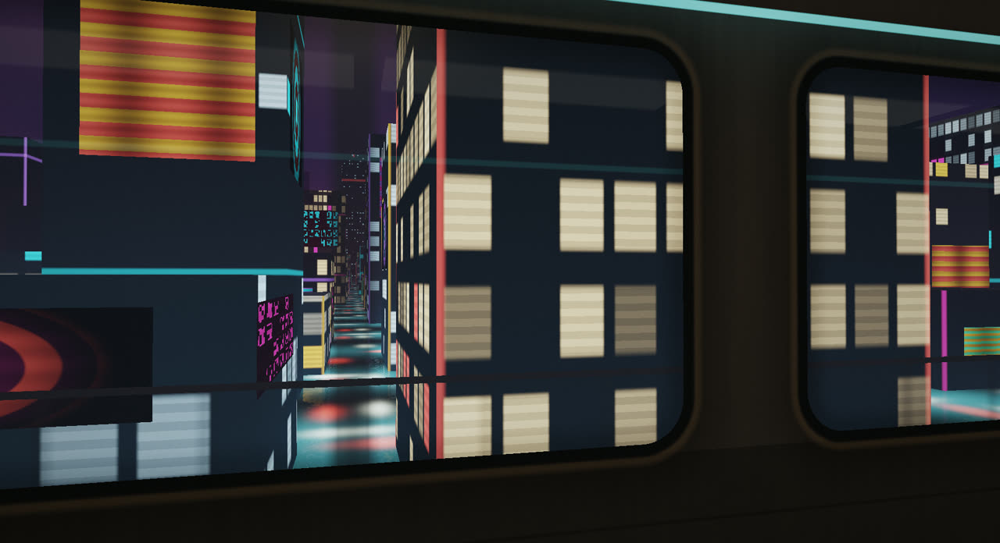

# Loop Line: a neon train screensaver for Omarchy

A real-time 3D screensaver for [Omarchy](https://omarchy.org). You sit by the
window of a metro train on an endless elevated loop through a neon city at
night. The train runs downtown, through a tunnel, past the old quarter, over a
bay bridge and through the yards, stops at four stations, and comes round
again about every six minutes.



The city is original and drawn live by one fragment shader. The sounds are
synthesized. Nothing is downloaded and the plugin makes no network requests.

## Install

```bash
omarchy plugin add https://github.com/PSthelyBlog/neon-train-screensaver.git --enable
```

A train icon appears in the bar.

Omarchy's own terminal screensaver would start underneath this one. Turn it
off once with:

```bash
omarchy toggle screensaver
```

To update:

```bash
omarchy plugin update io.github.psthelyblog.neon-train-screensaver
```

## Use

- Click the train icon for settings. Right-click it to ride now.
- Any key, click, or mouse movement ends the ride.
- From a terminal or a keybinding: `omarchy-shell loopline start|stop|toggle|status`,
  and `omarchy-shell loopline-panel toggle` for the settings.

The ride starts on its own idle timer (2.5 minutes by default). It does not
start while Omarchy's stay-awake switch is on, while an app inhibits idle, or
while the screen is locked, and it stops when the lock screen comes up. If
your lock delay (`idle.lock` in `~/.config/omarchy/shell.json`) is shorter than
the ride's delay, the lock wins and the ride never shows.

## Settings

Changed from the bar panel and kept in `~/.config/loopline/settings.json`:

| Setting | Choices |
|---|---|
| Start when idle | on or off, after 1, 2.5, 5 or 10 minutes |
| Quality | Low, Medium, High, Ultra: render scale, view distance, wet-street reflections |
| Frame rate | 30 or 60 fps |
| Rain | off, light, heavy |
| Station names | on or off |
| Sound | master switch, volume, and train, rain and station chimes separately |

## What it needs

- Omarchy with the Omarchy shell and Hyprland.
- `qt6-multimedia` for sound, `jq`, and `hyprctl`. A stock Omarchy has all three.
- A GPU. High at 1080p is light work for a recent card; pick Low or Medium on
  integrated graphics.

## What it changes on your system

- It creates `~/.config/loopline/settings.json`.
- While a ride is showing it sets Hyprland's `cursor:inactive_timeout` to 1
  second so a resting pointer hides, and puts the previous value back when the
  ride ends. Nothing is written to your Hyprland config files.

It does not edit `shell.json` or any other configuration of yours.

## Remove

```bash
omarchy plugin remove io.github.psthelyblog.neon-train-screensaver
rm -rf ~/.config/loopline          # its settings
omarchy toggle screensaver         # only if you turned Omarchy's screensaver off above
```

## Develop

```bash
/usr/lib/qt6/bin/qsb --glsl "100 es,120,150,300 es,330" -o shaders/ride.frag.qsb shaders/ride.frag
/usr/lib/qt6/bin/qsb -b --glsl "100 es,120,150,300 es,330" -o shaders/ride.vert.qsb shaders/ride.vert
python3 tools/gen-sounds.py      # needs numpy
node tests/sim.test.mjs
```

`Sim.js` and `shaders/ride.frag` share the layout of the line (loop length,
stations, tunnel); change them together. The shell keeps a running service
across hot reloads, so restart it (`omarchy restart shell`) after editing
`Service.qml`.

## License

MIT. See [LICENSE](LICENSE).
